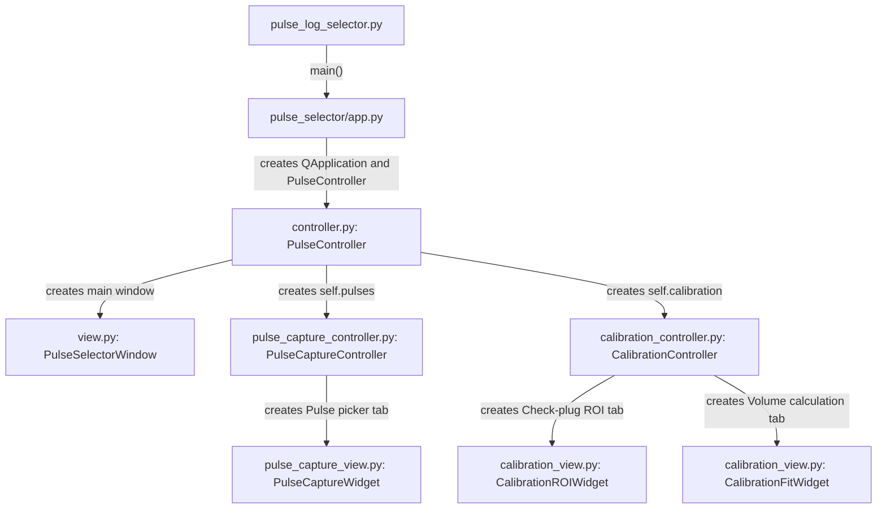
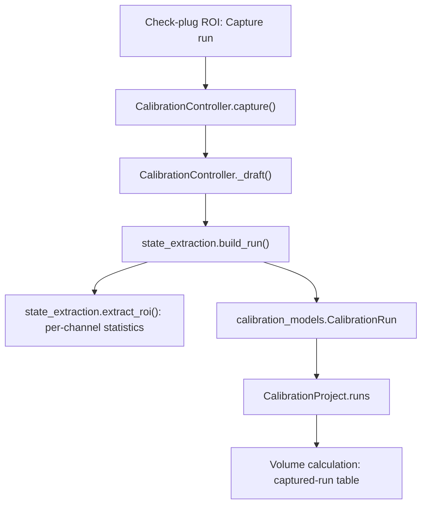
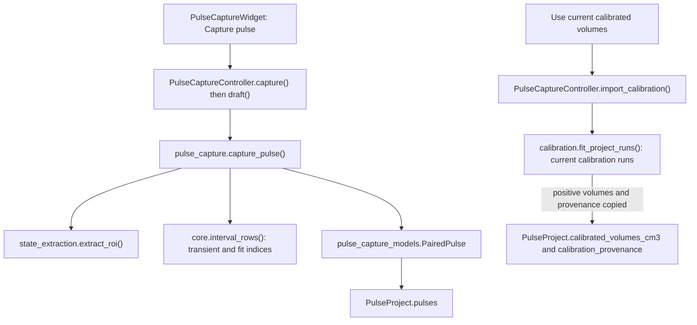

# Pulse picker architecture — version 4.0.1

Source-checked on 28 October 2026. This document describes the current implementation, including paired pulse capture and check-plug calibration. History matching and the late-time permeability method are not implemented in this version.

Version 4.0.1 simplifies the source syntax while retaining these modules and call paths. See `CODE_GUIDE.md` for a reading order, examples and explanations of the remaining Python/Qt features.

## How to read this document

This is a module-and-call diagram: boxes name Python modules or classes; labelled arrows describe calls or data passed between them. Most arrows omit return values. Python imports these modules into the same application process; the GUI does not launch a separate Python process for each calculation.

The design follows a Core vs. UI separation, with MVC-style controllers:

- **Views:** PySide6 widgets, pyqtgraph plots, controls and displayed results.
- **Controllers:** connect user actions to extraction, calculations and saving.
- **Models:** records holding recordings, selections, conditions and results.
- **Core:** data preparation, ROI statistics, pulse extraction and calibration mathematics.
- **I/O:** session serialization and Excel output.

This is a practical separation rather than a strict MVC framework. Views wire signals to controller methods and use some display helpers. I/O modules also invoke core routines to recompute or export results.

## 1. Application startup and controller ownership



`app.main()` shows the window and starts `QApplication.exec()`, the Qt event loop. Both calibration tabs belong to one controller and share one calibration project. The actual Pulse picker has its own controller and pulse project.

## 2. Shared recording import

1. **Open log** calls `PulseController.open_log()`.
2. `core.read_log()` reads the selected XLSX/XLS/CSV file.
3. `view.ColumnMappingDialog` collects the shared clock and channel mappings, including quantity, unit and upstream/downstream location.
4. `PulseController.load_frame()` calls `core.prepare_signals()` and updates `models.ApplicationModel` with the prepared recording and import diagnostics.
5. It calls both `PulseCaptureController.log_loaded()` and `CalibrationController.log_loaded()`.
6. Each controller calls `state_extraction.snapshot_log()`, stores a recording snapshot in its project and updates its view.

Previously captured records remain in their respective collections when another recording is opened. The imported recording and its snapshots preserve original-unit channel samples; graph/statistics conversion uses shared helpers in `core.py`.

## 3. Where the calibration algorithm lives

**All check-plug volume-fitting mathematics lives in `pulse_selector/calibration.py`.** This module does not depend on PySide6, pandas, file dialogs or the widgets. It receives data records and returns a `FitResult`.

Before fitting, **Capture run** follows this route:



`build_run()` checks the selected regions and chronology and creates the run record. Its ROI statistics include mean, sample SD, finite sample count, min/max, drift slope, coverage and source references. Capturing statistics and being ready for gas-law fitting are separate stages: fitting additionally requires complete pressure, temperature and assumption inputs.

**Calculate volumes** follows this sequence:

```mermaid
sequenceDiagram
    participant V as Volume calculation view
    participant C as CalibrationController
    participant S as calibration.py
    participant N as NumPy
    V->>C: calculate() from button click
    C->>S: fit_project_runs(project.runs, project.eos)
    Note over S: Validate exclusions; inputs_for_run() for each included run
    Note over S: Convert pressures to absolute kPa and temperatures to K
    Note over S: nitrogen_z() when Peng–Robinson is selected and Z is not overridden
    Note over S: fit_volumes(); design_row() for each prepared run
    S->>N: np.linalg.lstsq(X, y, rcond=None)
    N-->>S: volumes, rank, singular values
    Note over S: Compute residuals, diagnostics and conditional standard errors
    S-->>C: FitResult
    C->>V: show_fit(result)
```

The solver fits the four parameters in the order `VU, VD, DU, DD`. The mass-balance rows form `X × volumes = y`; they account for expansion side, plug configuration and known plug volume. The current fit is unweighted ordinary least squares using NumPy's SVD-based least-squares routine, with a rank-four requirement. It does not silently impose positive-volume constraints.

| Function in calibration.py | Responsibility |
| --- | --- |
| `fit_project_runs()` | Validate exclusions, select included runs, prepare inputs and call the fit |
| `inputs_for_run()` | Check required conditions; convert gauge pressure and Celsius; select initial/final tank temperatures; obtain Z factors |
| `nitrogen_z()` | Calculate the physical gas root of the Peng–Robinson nitrogen equation |
| `fit_volumes()` | Assemble and solve the four-volume system; return results and diagnostics |
| `design_row()` | Build one mass-balance matrix row and right-hand-side value |

The result contains fitted volumes, residuals, SSE/RMSE, R² when defined, rank, condition number, warnings and conditional standard errors when enough runs are available.

## 4. Actual pulse capture and the calibration reference



The blue and green regions define initial/final statistics. The orange valve marker defines the time origin. `capture_pulse()` stores the full transient indices from valve opening through the latest final-state endpoint, plus context and an optional independent fitting interval. It retains original sample times; it does not resample or fabricate a point at t=0.

A `PairedPulse` stores selections, statistics and row references. The full underlying measurements live in its project's `LogSnapshot`, linked by `dataset_id`. This avoids embedding a duplicate raw trace in every individual pulse record. A saved pulse JSON embeds the recording snapshots as well as the selections.

The calibration-copy button recomputes the fit from the current calibration collection and copies the positive fitted values and provenance into the pulse project. It is a saved reference, not a live link: later calibration changes require another copy action. It does not copy the pulse experiment's barometric pressure or run a permeability calculation.

## 5. Models and ownership

| Module | Main records | Owner or purpose |
| --- | --- | --- |
| `models.py` | `ApplicationModel`, `SignalChannel` | Main controller's currently imported recording and channel mapping; also contains older selection records |
| `calibration_models.py` | `LogSnapshot`, `ROIStatistics` | Shared by both workflows, despite the calibration filename |
| `calibration_models.py` | `CalibrationRun`, `CalibrationProject` | `CalibrationController.project`; check-plug runs, recordings and EOS choice |
| `calibration.py` | `RunInputs`, `FitResult` | Prepared physical inputs and returned numerical fit |
| `pulse_capture_models.py` | `PairedPulse`, `PulseProject` | `PulseCaptureController.project`; actual pulses, recordings, pressure setup and copied volume reference |

## 6. Saving, reopening and exporting

| User action | Controller route | I/O function | Output or effect |
| --- | --- | --- | --- |
| Save calibration session | `CalibrationController.save()` | `calibration_io.save_session()` | Calibration JSON with embedded recordings |
| Open calibration session | `CalibrationController.open_session()` | `calibration_io.load_session()` | Restore recordings and rebuild calibration run statistics |
| Export calibration | `CalibrationController.export()` | `calibration_io.write_calibration_workbook()` | Excel inputs, statistics, raw samples, fit results and residuals |
| Save pulses | `PulseCaptureController.save()` | `pulse_capture_io.save_pulse_session()` | Paired-pulse JSON with embedded recordings and selections |
| Open pulses | `PulseCaptureController.open_session()` | `pulse_capture_io.load_pulse_session()` | Restore recordings and recompute pulse selections/statistics |
| Export pulses | `PulseCaptureController.export()` | `pulse_capture_io.export_pulses()` | Excel transient, context, fit window, states, state samples and metadata |

The toolbar's **Export active tab** calls `PulseController.export_active_tab()`: tab 0 routes to pulse export; either calibration tab routes to calibration export.

There are two useful implementation dependencies to know about:

- `pulse_capture_io.py` reuses `calibration_io.py` recording save/load routines via `save_recordings` / `load_recordings` aliases, using a temporary recording-only calibration container. The user-facing pulse and calibration JSON formats remain distinct.
- Calibration Excel export calls the same solver to calculate its fit tables. Reopening sessions also invokes extraction to rebuild statistics. The I/O layer therefore does more than copy previously displayed numbers.

Original measurement files are protected from overwrite by these save/export paths. Capturing changes the in-memory project; the Save action writes a session file.

## 7. Command-line route to the same solver

`calculate_check_plug_volumes.py` is an alternative entry point, not a second calibration implementation:

```python
project = load_session(session_path)  # calibration_io.py
fit = fit_project_runs(project.runs, project.eos)  # calibration.py
```

Example, from the extracted application folder:

```bash
python calculate_check_plug_volumes.py check_plug_session.json --output fit.json
```

It writes/prints the fit without starting Qt. Changing `calibration.py` affects the GUI calculation, calibration Excel fit, calibration-reference copying and this command-line route.

## 8. Where to make future changes

| Desired change | Start in these modules |
| --- | --- |
| Button, field, plot appearance or ROI interaction | `pulse_capture_view.py` or `calibration_view.py` |
| Action handling, capture/edit workflow or dialog routing | Corresponding `*_controller.py` |
| Pressure/temperature import, time preparation or display-unit conversion | `core.py`; channel-mapping UI in `view.py` |
| ROI statistics used by both workflows | `state_extraction.py` |
| Full-transient boundaries, valve reference or fitting-window validation | `pulse_capture.py` |
| Check-plug equations, EOS or least-squares method | `calibration.py` |
| New stored fields | Relevant `*_models.py` plus corresponding serializer/loader |
| Excel sheets or session format | `calibration_io.py` or `pulse_capture_io.py` |
| Main tabs, application composition or shared import flow | `controller.py`, `view.py`, `app.py` |

`legacy_controller.py`, `legacy_view.py` and the older `export.py` are retained for the earlier picker/regression path. The version 4 launcher uses the paired-pulse controller/view described above.

For the next stage, FDM history matching and Dicker–Smits late-time calculations should live in additional core modules, with the algorithm selector and fitting actions in a corresponding UI/controller. Those are proposed extensions; no such permeability calculation is currently called by version 4.


## Version 4.1 permeability path

Select captured pulse → `PulseCaptureController.analyze_selected` →
`PermeabilityDialog` → `extract_trace` from the pulse's own snapshot →
worker invokes `late_time` or `history_match` → original `run_fdm` →
pressure/residual plots → `PulseProject.analysis_results` → pulse-session JSON.

The core module has no Qt dependency. The dialog handles display and worker
lifecycle. Forward physics stays in the original reference solver. Analysis
settings/results are keyed by captured pulse UID and fingerprinted against
source samples and conditions. The shared import model is not used as a
substitute for an older pulse's retained recording.


## Version 4.2 gas balance and sample regression

- Analysis → `PorosityDialog` → `porosity_from_pulse` → closed gas inventory / optional existing `nitrogen_z` → per-pulse saved estimate → explicit phi input update.
- Analysis → `KlinkenbergDialog` → reviewed current saved late-time fits → `fit_klinkenberg` → plotted sample regression → `PulseProject.sample_results` → optional fixed-b input update.
- Neither path changes captured source samples. Applying phi/b requires rerunning the permeability calculation.
